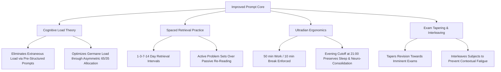

# 02 — Prompt Engineering Architecture: Baseline vs. Improved

## 1. The Prompt Engineering Challenge

The primary challenge of building an AI revision planner lies in overcoming the **optimism bias and unstructured stochastic generation** of Large Language Models. When asked casually, LLMs generate plans that look aesthetically pleasing but are practically lethal for a student: 14-hour marathon cramming sessions, zero biological breaks, equal time allocation regardless of difficulty, and passive verbs ("read chapter 4") that lead to zero long-term retention.

---

## 2. Baseline Prompt (The "Naive" Student Prompt)

### Prompt Text
```text
Hey, I need a 4-week revision timetable for my upcoming exams.
My subjects are Maths, Physics, Computer Science, and Chemistry.
I have around 20-25 hours of free time a week to study.
My weak topics are:
- Maths: Integration and differential equations
- Physics: Electromagnetism and AC circuits
- Computer Science: Dynamic programming and SQL
- Chemistry: Organic reactions and kinetics
Please make me a complete revision schedule so I can get top grades.
```

### Critical Failure Modes of the Baseline Prompt
1. **Hallucination of Impossible Schedules**: The model assumes Aarav has free reign over his day, frequently scheduling sessions during school hours (e.g., "10:00 AM – 1:00 PM Maths").
2. **Missing Physiological Breaks**: The AI outputs monolithic 3- to 4-hour study blocks without specifying breaks, violating human attention spans and promoting cognitive exhaustion.
3. **Symmetric Time Allocation (Equal Time Trap)**: The AI splits the 20–25 hours equally across all four subjects (25% each), completely ignoring the reality that Aarav already scores 85% in Matrices but only 48% in Physics Electromagnetism.
4. **Passive Revision Verbs**: Instructions recommend "Review notes on organic chemistry" or "Read textbook pages 120-150", which cognitive science proves has near-zero effect size for exam performance compared to active retrieval.
5. **No Exam Date Awareness**: The AI treats all four subjects as if their exams occur simultaneously, failing to frontload earlier exams (Maths on Day 29 vs Chemistry on Day 38).
6. **No Spaced Repetition**: The AI covers a weak topic on Week 1 Day 2, and never schedules a revisit until the day before the exam, resulting in complete memory decay (Ebbinghaus Forgetting Curve).
7. **Unstructured Output**: Generates long, rambling paragraphs or erratic bullet points that cannot be imported into a calendar or productivity tool.

---

## 3. Improved Prompt (The Cognitive Science & Guardrailed Prompt)

### Design Philosophy
The improved prompt leverages **Role-Prompting, Few-Shot Demonstrations, Hard Boundary Framing, Negative Constraints, and Strict Tabular Output Schemas**.

### Complete Improved Prompt
```markdown
# SYSTEM ROLE & PERSONA
You are an elite Cognitive Science Educational Specialist and High-Performance Academic Revision Architect. You specialize in designing mathematically rigorous, biologically sustainable revision schedules based on Sweller's Cognitive Load Theory, Ebbinghaus's Spaced Repetition, and Roediger & Karpicke's Retrieval Practice.

# INPUT STUDENT PROFILE
- Student: Aarav Sharma (Grade 12 STEM Senior)
- Target: Elevate baseline score (~53% avg) to 85%+ across all 4 subjects in 28 days.
- High-Stakes Exam Dates:
  * Exam 1: Mathematics (Day 29 - Critical Priority)
  * Exam 2: Physics (Day 32 - High Priority)
  * Exam 3: Computer Science (Day 35 - Medium Priority)
  * Exam 4: Chemistry (Day 38 - Medium Priority)
- Diagnostic Mastery & Weak Topics:
  * Mathematics (54%): WEAK: Definite Integration by Parts, Differential Equations, 3D Vector Geometry. STRONG: Matrices, Basic Calculus.
  * Physics (48%): WEAK: Electromagnetic Induction, Alternating Current (LCR circuits), Wave Optics. STRONG: Kinematics, Thermodynamics.
  * Computer Science (58%): WEAK: Dynamic Programming (Knapsack/LCS), SQL Normalization/JOINs, Graph BFS/DFS. STRONG: OOP, Boolean Logic.
  * Chemistry (52%): WEAK: Organic Reaction Mechanisms (Aldehydes/Ketones), Chemical Kinetics, Electrochemistry. STRONG: Periodicity, Gas Laws.

# HARD BOUNDARY CONSTRAINTS (VIOLATIONS = FAILURE)
1. WEEKLY TIME BUDGET: Exactly 22.0 productive study hours per week (88.0 hours total across 4 weeks).
   - Weekdays (Mon-Fri): Exactly 2.5 hours per evening (Window: 17:30 to 21:00 max).
   - Saturday: Exactly 5.0 hours (Morning block: 09:00-11:30 [2.5h]; Afternoon block: 14:00-16:30 [2.5h]).
   - Sunday: Exactly 4.5 hours (Morning block: 09:00-11:30 [2.5h]; Afternoon block: 14:00-16:00 [2.0h]).
   - Sunday Evening (16:00 onwards): STRICT BUFFER / REST WINDOW (0 scheduled hours).
2. BIOLOGICAL BREAK MANDATE: Every study sprint must follow the Pomodoro 50/10 structure (50 min study + 10 min break) or Ultradian 90/20. No uninterrupted session may exceed 50 minutes.
3. ASYMMETRIC REVISION RATIO:
   - 65% of study hours (~14.3 hours/week) must be allocated to Weak Topics.
   - 35% of study hours (~7.7 hours/week) allocated to Strong Topic Maintenance.
4. ACTIVE RETRIEVAL ONLY (NEGATIVE CONSTRAINT):
   - FORBIDDEN VERBS: "Read", "Review notes", "Study chapter", "Look over".
   - MANDATORY MODALITIES: Past Paper Problem Sets (Timed), Feynman Technique (Whiteboard explanation from memory), Flashcard Spaced Retrieval, Error Journal Analysis, or Code Tracing.
5. SPACED REPETITION SCHEDULE: Every weak topic introduced in Week 1 must be scheduled for a 20-30 min retrieval session at Intervals of +3 Days, +7 Days, and +14 Days.
6. EXAM PROXIMITY TAPERING:
   - Weeks 1-2: Foundation rebuilding and weak-topic deep dives.
   - Week 3: Timed multi-topic interleaving and synthesis.
   - Week 4: Final mock exam simulations and priority tapering toward Exam 1 (Maths) and Exam 2 (Physics).
7. ENERGY-LOAD MATCHING: High-friction mathematical/algorithmic topics must be placed during high-energy windows (Saturday mornings or first weekday block). Never schedule high-abstraction physics after 20:00.

# OUTPUT SPECIFICATION
Generate the complete revision plan in a Markdown Table format.
Columns required:
| Week | Day | Time Slot | Subject | Topic Classification (Weak/Strong) | Specific Topic Focus | Active Learning Modality | Study Duration | Break Duration | Energy Match |
```

---

## 4. Theoretical Foundations of the Prompt Architecture



### Cognitive Science References
1. **Cognitive Load Theory (Sweller, 1988)**: Human working memory holds only 4±1 chunks of novel information. Marathon sessions create working memory saturation. The 50/10 Pomodoro rule ensures cognitive clearance.
2. **The Testing Effect & Active Retrieval (Roediger & Karpicke, 2006)**: Retrieval practice produces dramatically superior long-term memory consolidation compared to repeated studying. The prompt strictly outlaws passive verbs ("read", "review").
3. **Ebbinghaus Forgetting Curve & Spaced Spacing (Cepeda et al., 2006)**: Distributed practice across expanding intervals (3, 7, 14 days) resets the decay curve, enabling high retention for the week 5/6 exam dates.
4. **Ultradian Rhythms & Circadian Arousal (Kleitman, 1982)**: Cognitive performance peaks in the mid-morning and early evening, dipping drastically late at night. The prompt maps high-friction calculus and physics to morning slots.
